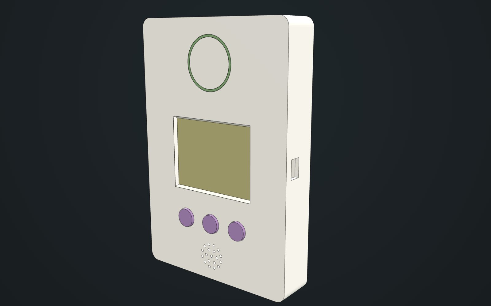

# Filament Tracker

A self-hosted system that tracks every Bambu Lab filament spool from delivery to empty, using the RFID tags already on the spools. Tap a spool on a small touchscreen scanner, confirm whether it is new, just opened or empty, and a central server keeps the inventory and feeds Home Assistant.

It runs entirely on your LAN in Docker, with no Bambu cloud dependency.

> **Status: early development.** This repo currently holds the spec, the enclosure design and a server skeleton. The features described below have not been built yet, and most of the software is planned to be built before the scanner hardware arrives. See [PROGRESS.md](PROGRESS.md) for current work.

[](https://sirmeili.github.io/3d-mockup-viewer/openscad/viewer.html?manifest=https://raw.githubusercontent.com/sirmeili/filament-tracker/main/hardware/enclosure/manifest.json)

## Goals

- See at a glance how many sealed and open spools exist for each filament (for example: Black PLA Basic, 3 sealed, 1 open).
- Record each spool's lifecycle with one tap and one confirm: New, Opened, Empty.
- Identify spools from their Bambu RFID tags, with no manual typing of type or color.
- Use P1S/AMS telemetry to fill in what the printer already knows: when a spool was first loaded and its remaining %.
- Surface low-stock alerts and inventory sensors in Home Assistant.

Writing or cloning tags, load-cell weighing, third-party filament without Bambu tags and slicer integration are out of scope for v1.

## How it works

1. **Tap.** The scanner reads the tag and asks the server what it knows about the spool.
2. **Confirm.** The screen shows the product, a color swatch and the current state, and highlights the suggested action. Confirm with one of the three buttons or by touch.
3. **Record.** The server logs the event and updates the inventory. If the server is unreachable, the scanner queues the event and retries.

Each spool carries two tags with different UIDs but the same tray UID. The tray UID is the spool's identity, so either tag works.

## Components

| Component | Role | Planned stack |
| --- | --- | --- |
| Scanner | Reads tags, derives keys and posts raw tag data; shows the spool and takes the action | ESP32 "Cheap Yellow Display", PN532 reader, three soft-key buttons; PlatformIO, Arduino, LVGL |
| Server | Decodes tags, stores every change as an immutable event, derives spool state and serves the API | Python 3.12, FastAPI, SQLAlchemy, SQLite, Alembic |
| Web UI | Check stock, fix mistakes and manage products and devices | Jinja2, HTMX |
| Printer link | Reads AMS trays read-only to detect opened spools and track remaining % | Local MQTT from the P1S |
| Home Assistant | Inventory and low-stock entities, plus events for automations | MQTT discovery, REST API |
| Scan simulator | Replays saved tag dumps so the server can be tested without hardware | Python |
| Screen simulator | Runs the real scanner screens on a PC, with the keyboard as buttons | LVGL |
| Fake printer | Replays AMS report messages over TLS so the printer link can be tested without a printer | MQTT |

## Enclosure

The scanner case is a parametric OpenSCAD model with the screen and buttons on the front and a flat "tap here" zone over the PN532 antenna. It holds the CYD, the PN532, the button board, a speaker and a USB-C power input. It is designed to mount on a wall by keyhole screws, magnets or Command strips, and can also sit on a shelf.

Select the image above to open the interactive 3D mockup. The source is in [hardware/enclosure/](hardware/enclosure/):

- [filament-scanner-case.scad](hardware/enclosure/filament-scanner-case.scad): the OpenSCAD model
- [manifest.json](hardware/enclosure/manifest.json): the part list and groups for the mockup viewer
- [preview.png](hardware/enclosure/preview.png): the rendered preview

## Roadmap

| Milestone | Scope |
| --- | --- |
| M0a Prove reading, phone | Dump two rolls of the same product with an Android app; confirm matching product fields and distinct tray UIDs; try reading through the shipping box |
| M1 Server core | Decoder, data model, event log, `/scans` API, scan simulator, tests |
| M2 Web UI | Inventory, spools, spool detail, review, devices |
| M5 Printer link | P1S MQTT ingest, automatic Opened, remaining %, likely-empty suggestions |
| M6 Home Assistant | MQTT discovery entities, events, low-stock automation |
| M3a Firmware without hardware | Scan flow, offline queue and dedupe logic with PC tests, screen simulator |
| M0b Prove reading, PN532 | Repeat the read tests on the bench rig; measure reading through the lid and shipping box |
| M3b Firmware on hardware | Breadboard build, real drivers, provisioning, OTA |
| M4 Enclosure | Printed case, button labels, antenna placement, final wiring |
| M7 Later | Future enhancements listed in the spec |

## Repository layout

```text
docs/SPEC.md         Full specification: the source of truth
hardware/enclosure/  3D model of the scanner case
server/              FastAPI server (currently a skeleton with a health check)
.github/workflows/   CI: lint, tests, 90% coverage gate and dependency audit
AGENTS.md            Rules for AI agents working in this repo
PROGRESS.md          Current status, next steps and decisions
```

## Documentation

[docs/SPEC.md](docs/SPEC.md) covers workflows, hardware, firmware, the data model, the API, security, testing and open questions.

Secrets such as the tag key-derivation constant, tokens and the printer access code are supplied as configuration and are never committed.

## Development

The server needs Python 3.12 and [uv](https://docs.astral.sh/uv/). From `server/`:

```sh
uv sync                # Install dependencies
uv run pytest          # Run tests with the 90% coverage gate
uv run ruff check .    # Lint
uv run uvicorn filament_tracker.main:create_app --factory --reload
```
